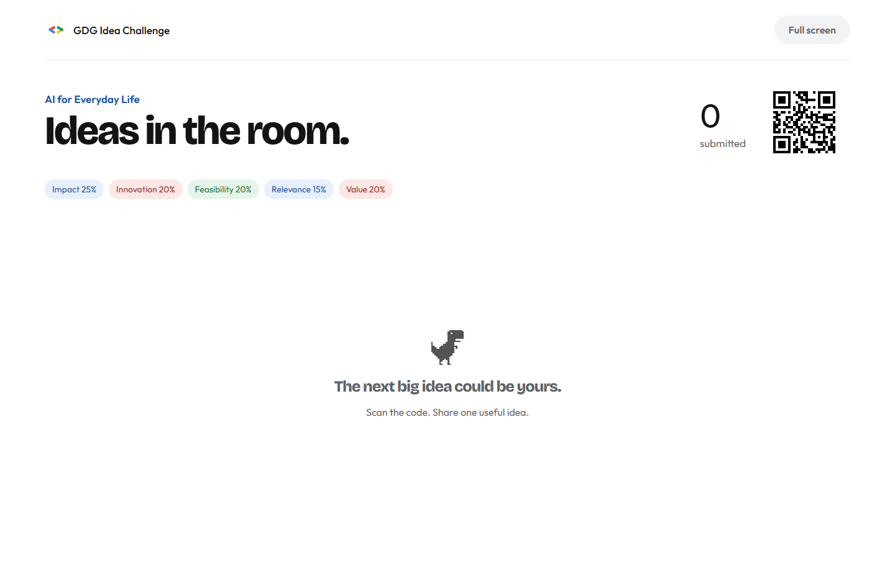

<p align="center">
  
</p>

# Re:Zero Beginner Series — Hackathon Masterclass

An interactive workshop with 16 slides, animated Chrome dinosaurs, project demos and a live idea challenge. Participants submit a title and an introduction of up to 200 words; the host reviews a rubric-based ranking before revealing the top three.

[Live slides](https://gdg-on-top.up.railway.app/Hackathon-Tips.html) · [Live board](https://gdg-on-top.up.railway.app/board) · [Submit an idea](https://gdg-on-top.up.railway.app/join) · [Presenter script](gdg%20hackathon%20sharing/Presenter-Script.md) · [Independent backup](https://github.com/Chee613/gdg-workshop-backup)



## Start locally

Python **3.12+** is used for the server. Run these commands from the repository root:

```powershell
python -m pip install -r "gdg hackathon sharing/requirements.txt"
python "gdg hackathon sharing/workshop/server.py"
```

| Page | Local address | Purpose |
| --- | --- | --- |
| Slides | http://127.0.0.1:8776/Hackathon-Tips.html | Present the workshop; use ← / → to navigate |
| Participant form | http://127.0.0.1:8776/join | Project title and introduction; maximum 200 words |
| Live board | http://127.0.0.1:8776/board | Public project titles, then the revealed top three |
| Host dashboard | http://127.0.0.1:8776/host | Configure, export ideas, judge and reveal results |

The server prints a participant address and generates its QR code at startup. Phones must be able to reach that address. Use the public deployment for participants on different networks; a localhost address cannot be scanned from another phone.

The checked-in HTML and assets are ready to serve. Node.js is needed only when editing or rebuilding the presentation.

## Configure the host

Set private variables in the deployment environment, or in the terminal that starts the server. The application does **not** automatically read `.env` files.

| Variable | Purpose |
| --- | --- |
| `GEMINI_API_KEY` | Gemini API key; `GOOGLE_API_KEY` is an alternative |
| `GEMINI_MODEL` | Optional; defaults to `gemini-3.5-flash-lite` |
| `WORKSHOP_HOST_PASSWORD` | Host password; at least 16 characters for hosted deployments |
| `WORKSHOP_DATA_DIR` | SQLite directory; use a persistent volume in production |
| `WORKSHOP_PUBLIC_URL` | Optional public origin for the generated participant QR |
| `PORT` | HTTP port; local default 8776, supplied by the hosting platform in production |

The host username is **`presenter`**. There is no default password. Without a configured password, host controls are available only from the loopback computer. The Docker image requires authentication. API keys never reach participants or the repository.

Use the [Railway deployment guide](gdg%20hackathon%20sharing/RAILWAY.md) for HTTPS, a persistent `/data` volume and `/healthz`. Deployments should track **`main`**. If an existing Railway service still tracks `codex/hackathon-masterclass-live-board`, change its source branch to `main` after the merge.

## Run the challenge

1. Set the theme and criteria in the host dashboard. The default is **AI for Everyday Life**.
2. Share the participant QR code. Gemini is optional; both apps also support manual scoring and ChatGPT CSV imports.
3. Collect ideas. Only titles appear on the public wall; introductions remain private to the host and are sent for judging.
4. Click **Export ideas** to download a private recovery file before analysing. Repeat the export when new ideas arrive.
5. Choose **Judging method**: **Gemini analysis** sends the entire round in one request; **Manual scoring** accepts a score for every criterion; **ChatGPT / CSV import** exports a complete prompt and accepts its scored CSV answer. Close submissions before using either fallback.
6. Review the complete ranking in the host dashboard, then **Reveal top three**. The public board exposes only those three results.
7. **New round** archives the previous round and opens a fresh collection.

### Rubric

| Participant label | Weight | What the judge considers |
| --- | --- | --- |
| Impact | 25% | Meaningful, measurable benefits for people, communities or the environment |
| Innovation | 20% | Useful differentiation, including thoughtful reuse of existing technology |
| Feasibility | 20% | A realistic pilot, resources, adoption and practical constraints |
| Relevance | 15% | A clear connection to AI for Everyday Life and a PEOPLE or PLANET problem |
| Value | 20% | Sustainable delivery, time/cost savings and potential to scale |

Full criterion names and detailed guidance stay in host controls and the judging request. The server validates weights totaling 100%, every returned idea ID, complete criterion coverage and finite scores from 0–10. It computes weighted totals itself and resolves equal totals by idea ID. AI scores remain a discussion aid, not independently verified evidence of project quality.

### Fifty submissions and Gemini limits

**Fifty submissions still use one `generateContent` request**, not fifty requests. Each title and full introduction is included with one indexed rubric. A regression check covers 50 introductions of 200 words, shuffled response IDs and the resulting weighted totals.

Fifty maximum-length descriptions contain 10,000 words. Typical English may require roughly 15,000–20,000 input tokens after adding titles, JSON and guidance; this is an estimate, not a tokenizer measurement. The [model documentation](https://ai.google.dev/gemini-api/docs/models/gemini-3.5-flash-lite) lists a 1,048,576-token input limit and 65,536-token output limit. The application reserves up to 12,000 output tokens for a 50-entry ranking.

Context capacity does not guarantee quota. [Google rate limits](https://ai.google.dev/gemini-api/docs/rate-limits) include requests per minute, input tokens per minute and requests per day, and apply per project. Check the **active limits and billing balance of the API key's project** in AI Studio. A different key in the same project shares those limits. Retrying a failed analysis makes another request; the application does not silently create one request per participant or switch models.

## Manual scoring, ChatGPT and recovery

Both repositories support **Gemini, manual host scoring and ChatGPT CSV import**. No Gemini key is needed for either fallback. The [judging guide and exact CSV contract](gdg%20hackathon%20sharing/workshop/JUDGING.md) document the workflow, dynamic criterion columns, quoting rules and rejection cases. The complete Markdown export contains the actual theme, full private rubric, all titles and introductions, IDs, round fingerprint and instructions for ChatGPT to return an importable CSV.

In `/host`, choose **ChatGPT / CSV import**, close submissions, and download **Export ChatGPT prompt (.md)**. Upload it to ChatGPT, import its complete CSV under **Import judged scores CSV**, review the full ranking, then **Reveal top three**. Alternatively, export the enriched CSV and fill its score columns. The server rejects outdated exports, missing ideas, invalid scores and mismatched criterion columns. It calculates weighted totals itself and never reveals on import.

The [backup repository](https://github.com/Chee613/gdg-workshop-backup) remains an independent, smaller application with its own server, form, live board, SQLite database and deployment. Configure its own `GEMINI_API_KEY` if you want Gemini there; it still runs without one.

1. Download **Export ideas** from the main host dashboard while the main service is available.
2. Open the separately hosted backup `/host` and import that JSON into an empty round. The exact theme, rubric and introductions are restored together.
3. Choose manual scoring or Gemini, or generate a **fresh ChatGPT export on the backup** and import its returned scores. Recovery assigns local IDs; a CSV generated for the main deployment may not match the backup round.
4. If continuing collection on the backup, share **its own** QR/link. The main QR does not automatically redirect.

There is no automatic cross-repository database sync. Keep recovery files private: they contain participant introductions. If the main service fails before an export, only an earlier export or the main database can restore those entries; otherwise participants must resubmit to the backup. Use a separate deployment and volume so a failure in the main application does not share its process or database with the backup.

## Repository guide

| Location | Responsibility |
| --- | --- |
| [Workshop guide](gdg%20hackathon%20sharing/README.md) | Presentation controls, local use and editing |
| [Presenter script](gdg%20hackathon%20sharing/Presenter-Script.md) | All 16 slides, audience prompts and demo cues |
| [Railway guide](gdg%20hackathon%20sharing/RAILWAY.md) | Deployment, authentication, storage and rehearsal |
| [Live challenge guide](gdg%20hackathon%20sharing/workshop/README.md) | Host workflow, rubric and data recovery |
| [Judging and CSV guide](gdg%20hackathon%20sharing/workshop/JUDGING.md) | Gemini/manual fallback, ChatGPT instructions and exact import format |
| `gdg hackathon sharing/output/` | Published HTML, images, scripts and session pages |
| `gdg hackathon sharing/workshop/server.py` | Submission API, persistence, authentication and Gemini judging |
| `gdg hackathon sharing/remotion/` | React/Remotion dinosaur animation source |
| `.hack-build/` | Deck specification, HTML builder and regression checks |

## Edit and verify

With Node.js **20+** and Chrome installed:

```powershell
npm --prefix .hack-build ci
npm --prefix "gdg hackathon sharing/remotion" ci
python .hack-build/rearrange-deck.py
node .hack-build/bundle-motion.mjs
node .hack-build/build-html.mjs
python .hack-build/verify-hosting.py
python "gdg hackathon sharing/workshop/test_judging.py"
node .hack-build/verify-judging-ui.mjs
node .hack-build/verify-workshop.mjs
node .hack-build/verify-html.mjs
```

The hosting and judging checks cover the single-request 50-entry scenario, provider-failure fallback, complete CSV validation, custom rubrics, weighted totals and persistence. Browser checks cover manual scores/drafts, prompt downloads, CSV uploads and reveal in both applications. They use isolated data and a synthetic provider; no real Gemini requests or live submissions are used. The two-app browser check expects the independent backup checkout at `.hack-build/backup-repo`; without it, it checks the main application only.
