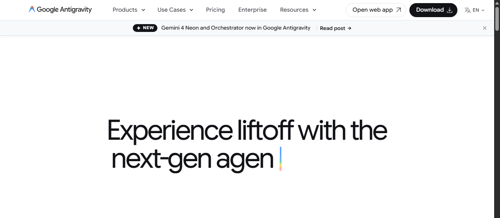
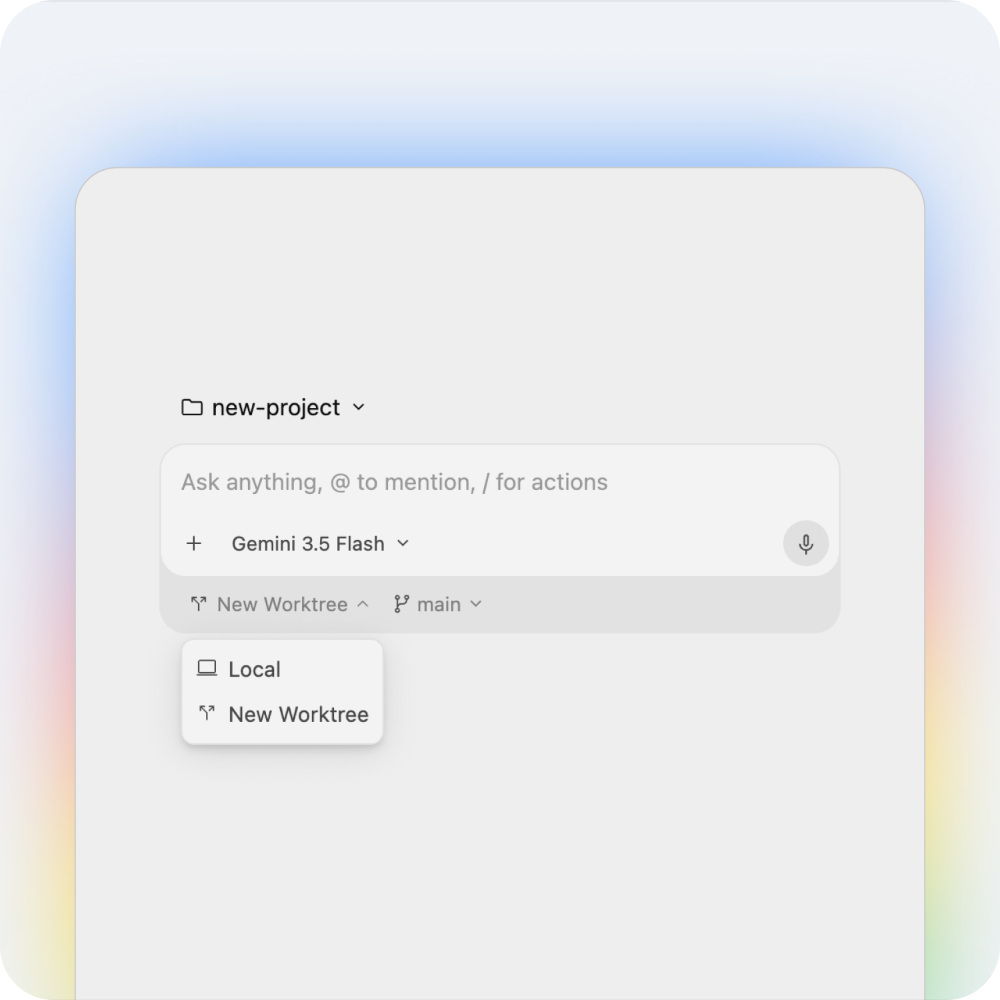

# 🚀 Google Antigravity IDE — Installation & Setup Guide

**AI-First Code Editor Built on VS Code with Autonomous Agent Capabilities**

Google Antigravity is an AI-first development environment built directly on VS Code. Unlike traditional editors that just autocomplete code, Antigravity features autonomous agent pair programming (powered by Gemini models) that can read your workspace, run terminal commands, manage dependencies, and troubleshoot errors for you.

---

## 📥 Step 1: Download & Install Antigravity

Download the official installer for your operating system:
* 🌐 **Download Portal:** [antigravity.google ↗](https://antigravity.google)
* **Windows:** Download `AntigravitySetup-x64.exe` and run the installer.
* **macOS:** Download `Antigravity.dmg`, open it, and drag the Antigravity icon into your `Applications` folder.
* **Linux:** Download the `.deb` or `.rpm` package and install via your package manager.



---

## 🔐 Step 2: Sign In with Your Personal Google Account

1. Launch **Google Antigravity**.
2. Click **Sign In** when prompted.
3. **CRITICAL:** Sign in with your **personal `@gmail.com` account**.

> ⚠️ **Avoid University Emails:** Institutional emails (e.g. `@siswa.um.edu.my`) often have administrator restrictions that block external AI API keys and Google One subscriptions.

---

## 💬 Step 3: Open Agent Chat & Run 1-Prompt Setup

Antigravity includes a native Agent Chat panel that can autonomously configure the entire workshop repository, install Python packages, and set up your environment.

1. Open your workspace folder in Antigravity (`File` → `Open Folder...`, e.g. `Documents`).
2. Press **`Ctrl + L`** (Windows/Linux) or **`Cmd + L`** (macOS) to open the **Agent Chat** sidebar.
3. Copy and paste the following prompt into the chat:

```text
Please set up the gdg-personal-productivity-agent project for me:
1. Clone https://github.com/faizmibadurrahman/gdg-personal-productivity-agent.git
2. Create an isolated Python virtual environment (.venv) using Python 3.11 or 3.12.
3. Install dependencies from requirements.txt into .venv.
4. Copy productivity_agent/.env.example to productivity_agent/.env.
5. Ask me for my Gemini API key to insert into .env, then verify the setup is ready.
```



4. The Antigravity agent will automatically:
   - Clone the GitHub repository.
   - Set up the isolated `.venv` environment.
   - Run `pip install -r requirements.txt`.
   - Copy the configuration `.env` file.
   - Ask you to provide your Gemini API key (see the main **Workshop Setup Guide** or **Gemini Plus Redemption Guide** tab for getting a key).

---

## 🚀 Step 4: Launch & Verify Your Agent

Once Antigravity completes the setup:
1. Open the integrated terminal in Antigravity (``Ctrl + Shift + ` ``).
2. Run the ADK web server:
   * **Windows:**
     ```powershell
     .\.venv\Scripts\adk.exe web
     ```
   * **macOS / Linux:**
     ```bash
     .venv/bin/adk web
     ```
3. Open your browser and navigate to: **[http://localhost:8000](http://localhost:8000)**.
4. Select `productivity_agent` in the dropdown, click **Start Session**, and send:
   > *"What tasks do I have?"*
5. You should see the agent call `get_tasks()` and return sample tasks!
