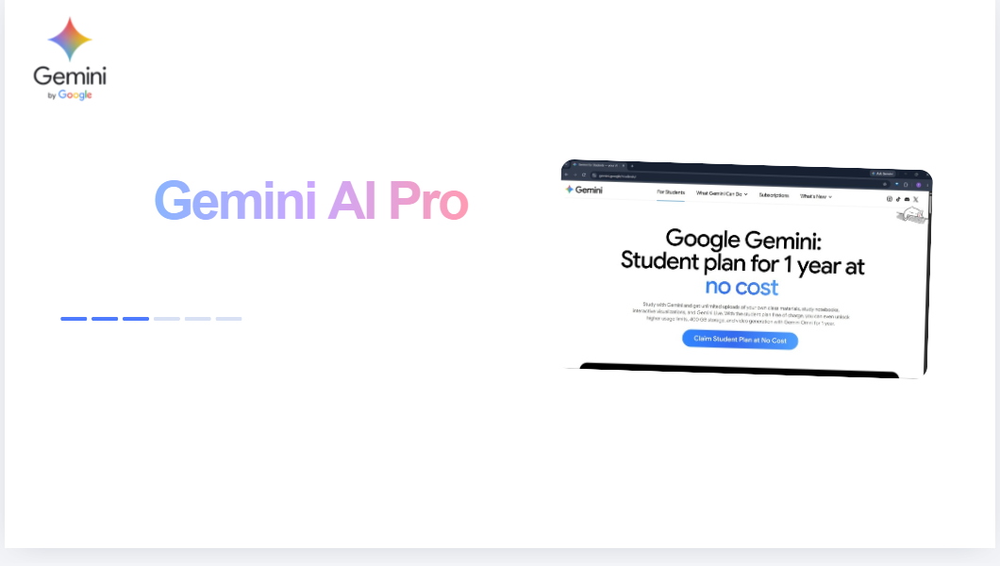

# 🎁 Gemini AI Pro — 1-Year Subscription Redemption Guide

**Google Gemini: Student Plan for 1 Year at No Cost (Google One AI Premium)**

Workshop participants are eligible to claim a complimentary 12-month **Google One AI Premium** subscription (valued at ~RM97.90/month or USD 19.99/month), giving you unrestricted access to Google's flagship AI models and 2 TB of cloud storage.

* 🎨 **Official Canva Presentation:** [How to Redeem Gemini Plus Subscription (Canva Slide) ↗](https://canva.link/rfqh4rvnmxlw7zt)

---

## 💎 What Is Included in This Plan?

| Benefit | Feature Details |
| :--- | :--- |
| **Gemini Advanced** | Priority access to Gemini 2.5 Pro and 1.5 Pro with next-gen reasoning and multimodal understanding. |
| **2 TB Cloud Storage** | Massive shared storage across Google Drive, Gmail, and Google Photos. |
| **Gemini in Workspace** | Built-in AI assistance in Google Docs, Sheets, Slides, and Gmail to draft, summarize, and generate content. |
| **High Quota Limits** | Significantly higher prompt throughput and context window sizes for workshop development. |

---

## 📝 Step-by-Step Claim Walkthrough

Follow these steps (derived from the visual Canva guide) to redeem your subscription:

### Step 1: Open the Offer Page
* Search for **"Google Gemini: Student plan for 1 year at no cost"** or navigate directly via the Canva slide link: [How to Redeem Gemini Plus Subscription](https://canva.link/rfqh4rvnmxlw7zt).
* Ensure you are signed in with the personal `@gmail.com` account where you want the subscription activated.

### Step 2: Click "Claim Student Plan at No Cost"
* Locate the blue **`Claim Student Plan at No Cost`** button on the offer landing page and click it.

### Step 3: Verify Student Status via SheerID
* Google partners with **SheerID** to verify enrolled higher-education students.
* Select your university/institution (e.g., *Universiti Malaya*).
* Enter your first name, last name, date of birth, and student email address (`@siswa.um.edu.my`).
  > 📌 *Note: While your university email is used for student verification with SheerID, the subscription itself can be bound to your personal Google account.*

### Step 4: Upload Proof of Student Enrollment
* If instant email verification is not immediately available, upload a photo or document confirming active enrollment:
  * University Student Matriculation ID Card (Front & Back).
  * Current Semester Registration / Enrollment Slip.
  * Official Class Timetable showing your name and current academic session.

### Step 5: Verification Review & Approval
* SheerID verifies documents automatically within a few seconds to a few minutes.
* Once approved, you will see the **"Approved! Press Continue"** confirmation screen.

### Step 6: Activate Google One Subscription
* Click **Continue** to transition to Google One checkout.
* Confirm the promo details: **12 months at no cost (RM0.00)**.
* Complete the activation.

### Step 7: Confirm Your AI Premium Badge
* Go to [gemini.google.com](https://gemini.google.com).
* Check the top banner: you should now see the **Gemini Advanced** / **AI Premium** badge active on your account!
* Visit [one.google.com](https://one.google.com) to verify your 2 TB storage quota and expiration date (12 months from redemption).

---

## ⚠️ Gotchas & Troubleshooting

1. **Already in a Google One Family Group:** If your Google account is currently in a family plan where someone else manages billing, you may need to temporarily leave the family group to activate an individual AI Premium promo.
2. **Payment Method Verification:** Google may ask for a payment card to verify identity (it will charge RM0.00 / USD 0.00, with no fee during the 12-month promotional period). Set a calendar reminder before the 1-year mark if you do not wish to renew.
3. **Card Document Quality:** Ensure photos of your student ID are clear, unblurred, and show your full name, student ID number, and university logo.
