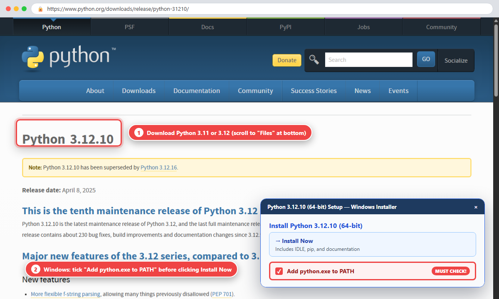
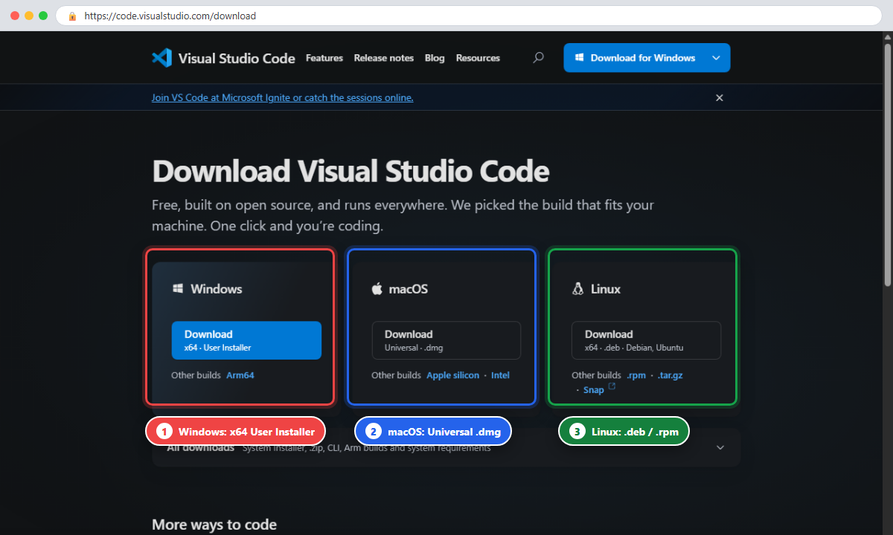
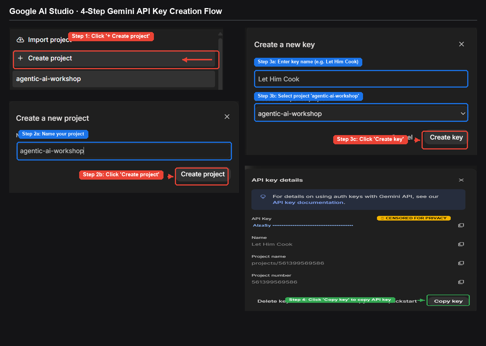
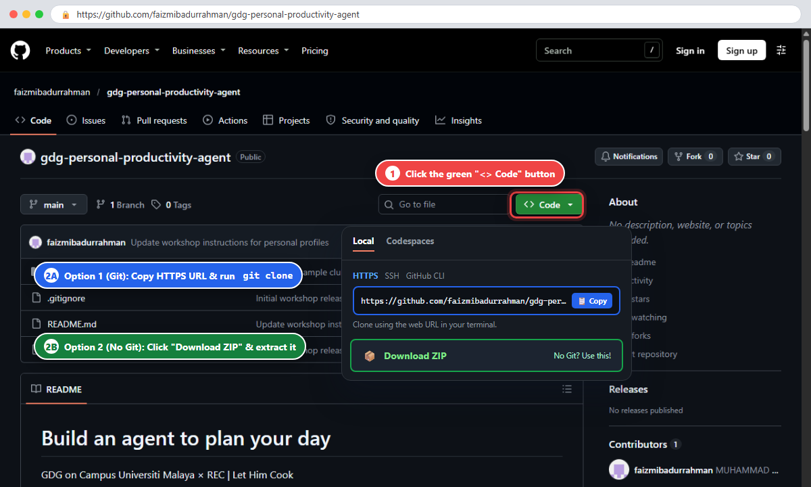
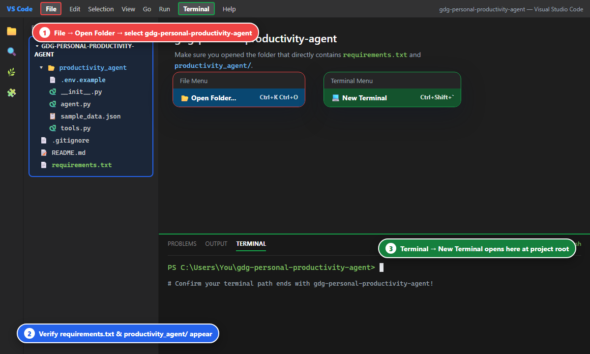
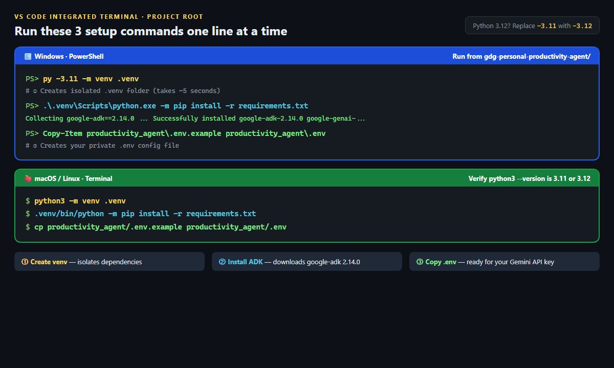
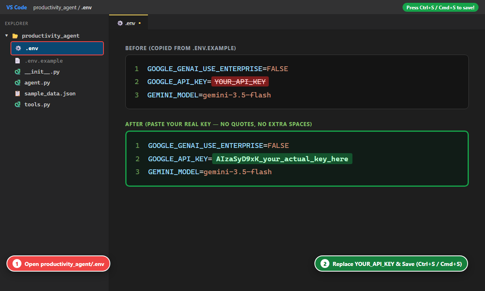
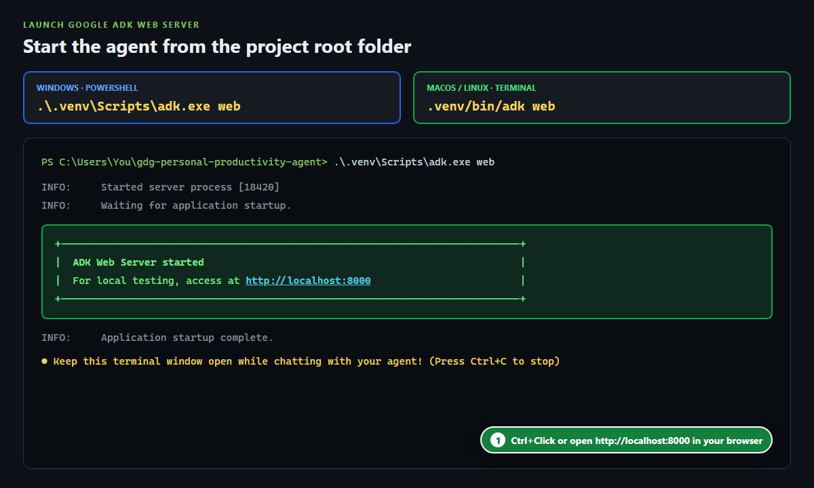
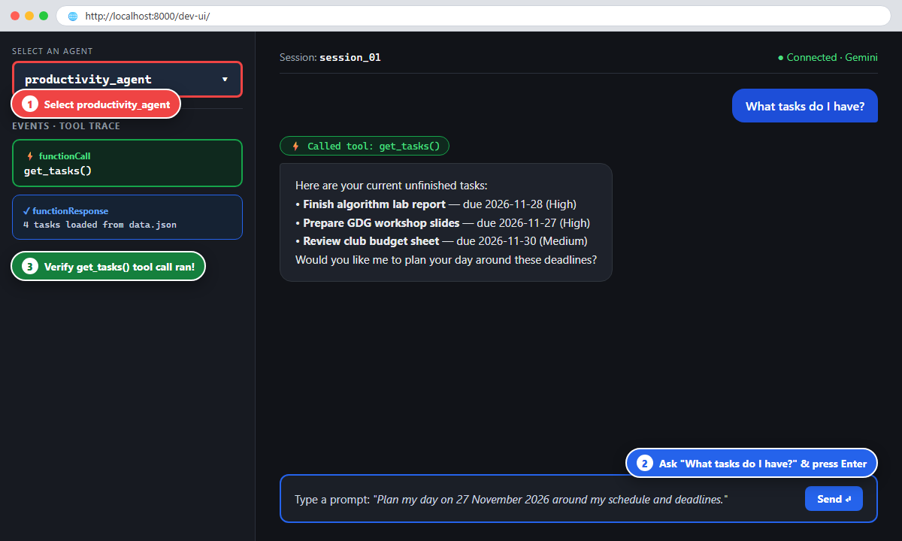

# Agentic AI Workshop — Participant Setup Guide

**GDG on Campus Universiti Malaya × Robotics Engineering Club | "Let Him Cook"**

Get your laptop ready in ~10 minutes to run your own personal productivity agent with **Google ADK** and **Gemini**. All download and setup links below are direct.

> 💡 **Notice for Participants Without an AI Coding Assistant:**  
> If you don't already have an AI assistant (like Claude Code, Codex, or Cursor), **please check the `Antigravity Setup Guide` and `Gemini Plus Redemption Guide` tabs in the left sidebar first!**  
> • **Antigravity Setup Guide Tab:** Install Google Antigravity IDE (free, AI-first) and use its built-in agent to set up and run this entire workshop automatically in 1 prompt.  
> • **Gemini Plus Redemption Guide Tab:** Claim 12 months of complimentary Google One AI Premium (Gemini Advanced).

---

## ⚡ Choose Your Setup Path

Choose the setup method that fits how you work:

* 🤖 **Option 1: The "Lazy Way" (Agent 1-Prompt Auto-Setup):** Have Google Antigravity, Claude Code, Codex, or Cursor? Drop our setup prompt into your agent and let it configure Python, virtual environment, and files automatically. *(See the **Antigravity Setup Guide** tab for complete installation instructions and screenshots).*
* 🛠️ **Option 2: The Step-by-Step Manual Way (VS Code / Terminal):** Follow the visual walkthrough below with direct download links and commands.
* ☁️ **Plan B: 1-Click Cloud (GitHub Codespaces):** Runs 100% in your browser without installing anything locally.

---

## 1. Pre-Workshop Checklist

| Requirement | Supported Version | Quick Verification | Direct Download Link |
| :--- | :--- | :--- | :--- |
| **Python** | 3.11 or 3.12 (avoid 3.13) | `py --list` (Win) / `python3 --version` (Mac) | [Windows Installer](https://www.python.org/ftp/python/3.12.10/python-3.12.10-amd64.exe) · [macOS Installer](https://www.python.org/ftp/python/3.12.10/python-3.12.10-macos11.pkg) · [All Python Downloads](https://www.python.org/downloads/release/python-31210/) |
| **Code Editor** | Antigravity or VS Code | Open from Start / Applications | [Antigravity IDE](https://antigravity.google) · [VS Code Windows (x64)](https://code.visualstudio.com/sha/download?build=stable&os=win32-x64-user) · [VS Code macOS](https://code.visualstudio.com/sha/download?build=stable&os=darwin-universal) |
| **Git** *(Optional)* | Any recent version | `git --version` (or use direct ZIP) | [Git Windows 64-bit](https://github.com/git-for-windows/git/releases/download/v2.47.1.windows.1/Git-2.47.1-64-bit.exe) · [Direct Project ZIP](https://github.com/faizmibadurrahman/gdg-personal-productivity-agent/archive/refs/heads/main.zip) |
| **Gemini API & Subscription** | Free tier + Gemini Plus perk | Sign in with personal Gmail | [Direct Key Creator (AI Studio)](https://aistudio.google.com/app/apikey) · [Redeem Gemini Plus Guide ↗](https://canva.link/rfqh4rvnmxlw7zt) |

> 🎁 **Complimentary Workshop Perk — Gemini Plus Subscription:**  
> Workshop participants can claim a complimentary 1-year Gemini Plus / Google One AI Premium subscription! Follow the official Canva walkthrough slide:  
> 👉 **[How to Redeem Gemini Plus Subscription (Canva Guide)](https://canva.link/rfqh4rvnmxlw7zt)** *(Or check the **Gemini Plus Redemption Guide** tab on the left).*

> ⚠️ **Personal Gmail Required:** You must generate your Gemini API key using a **personal `@gmail.com` account**. University student emails (`@siswa.um.edu.my`) block external AI API key creation.

> 🔒 **Privacy Note:** Use fictional or non-sensitive details for tasks and schedules. Prompts and tool outputs are processed by Gemini. Keep your API key private.

---

## 🤖 Option 1: The "Lazy Way" (Agent 1-Prompt Auto-Setup)

If you are using **Google Antigravity**, **Claude Code**, **Codex**, or **Cursor**, you can let your agent configure everything autonomously.

1. Open your agent chat sidebar (`Ctrl+L` / `Cmd+L`).
2. Paste this single setup prompt into the chat:

```text
Please set up the gdg-personal-productivity-agent project for me:
1. Clone https://github.com/faizmibadurrahman/gdg-personal-productivity-agent.git
2. Create an isolated Python virtual environment (.venv) using Python 3.11 or 3.12.
3. Install dependencies from requirements.txt into .venv.
4. Copy productivity_agent/.env.example to productivity_agent/.env.
5. Ask me for my Gemini API key to insert into .env, then verify the setup is ready.
```

3. Paste your Gemini API key when prompted, then launch the agent with `.\.venv\Scripts\adk.exe web` (Windows) or `.venv/bin/adk web` (macOS/Linux).
> 📘 **New to Antigravity?** Refer to the **Antigravity Setup Guide** tab on the left sidebar for step-by-step download, sign-in, and installation screenshots!

---

## 🛠️ Option 2: Step-by-Step Manual Setup (VS Code / Terminal)

### Step 1: Install Python 3.11 or 3.12
1. Check version in terminal: `py --list` (Win) or `python3 --version` (Mac). If missing, download directly: [Windows Direct Installer (.exe)](https://www.python.org/ftp/python/3.12.10/python-3.12.10-amd64.exe) or [macOS Direct Installer (.pkg)](https://www.python.org/ftp/python/3.12.10/python-3.12.10-macos11.pkg).
2. **Windows:** **CRITICAL** — Check **"Add python.exe to PATH"** on the first installer screen.
3. **macOS:** Open Applications → Python 3.12 → double-click **`Install Certificates.command`** (fixes SSL errors).



---

### Step 2: Install Visual Studio Code
Download directly: [VS Code for Windows (x64 User Installer)](https://code.visualstudio.com/sha/download?build=stable&os=win32-x64-user) or [VS Code for macOS (Universal)](https://code.visualstudio.com/sha/download?build=stable&os=darwin-universal).



---

### Step 3: Get Your Free Gemini API Key & Redeem Gemini Plus
1. Open the [Google AI Studio API Key Console](https://aistudio.google.com/app/apikey) directly (sign in with your personal `@gmail.com`).
2. Click **+ Create API key**.
3. In the project dropdown, select **`+ Create project`**, type a project name (e.g. `agentic-ai-workshop`), and click **`Create project`**.
4. In the next popup, name your key (e.g. `Let Him Cook`), confirm the project is selected, and click **`Create key`**.
5. When the **API key details** modal appears, click **`Copy key`** and save it. (Never share or publicly commit your API key!).
6. 🎁 **Claim Your Gemini Plus Subscription:** Follow the visual Canva guide at **[How to Redeem Gemini Plus Subscription](https://canva.link/rfqh4rvnmxlw7zt)** (or check the **Gemini Plus Redemption Guide** tab on the left) to activate your complimentary Google One AI Premium / Gemini Plus perks!



---

### Step 4: Download & Open the Project
* **Option A (Git):** In your terminal, run:
  ```bash
  git clone https://github.com/faizmibadurrahman/gdg-personal-productivity-agent.git
  ```
* **Option B (Direct ZIP Download):** Download the [Starter Project ZIP directly](https://github.com/faizmibadurrahman/gdg-personal-productivity-agent/archive/refs/heads/main.zip), extract it, and open the folder in VS Code (`File` → `Open Folder...`).
* **Sidebar check:** Ensure `requirements.txt` is directly visible in the root sidebar (not nested inside an outer folder).
* **Terminal shortcut:** Press ``Ctrl+Shift+` `` (Windows) or ``Cmd+Shift+` `` (macOS) to open the integrated terminal.





---

### Step 5: Setup Environment & Install Dependencies
Run these 3 commands in your VS Code terminal:

**Windows (PowerShell):**
```powershell
py -3.12 -m venv .venv
.\.venv\Scripts\python.exe -m pip install -r requirements.txt
Copy-Item productivity_agent\.env.example productivity_agent\.env
```

**macOS / Linux (Terminal):**
```bash
python3 -m venv .venv
.venv/bin/python -m pip install -r requirements.txt
cp productivity_agent/.env.example productivity_agent/.env
```



---

### Step 6: Configure Your Gemini API Key
1. In VS Code, open `productivity_agent/.env`.
2. Replace `YOUR_API_KEY` with your actual Gemini API key (no quotes, no extra spaces):
   ```ini
   GOOGLE_GENAI_USE_ENTERPRISE=FALSE
   GOOGLE_API_KEY=AIzaSy_your_actual_key_here
   GEMINI_MODEL=gemini-3.5-flash
   ```
3. Save the file (`Ctrl+S` / `Cmd+S`).  
   *(Note: If `gemini-3.5-flash` gives quota errors during testing, change model to `GEMINI_MODEL=gemini-2.0-flash`).*



---

### Step 7: Launch the Agent Web Server
From the project root terminal, run:
* **Windows:**
  ```powershell
  .\.venv\Scripts\adk.exe web
  ```
* **macOS / Linux:**
  ```bash
  .venv/bin/adk web
  ```
*(If port 8000 is occupied, add `--port 8080`). Keep this terminal open and running!*



---

### Step 8: Verify & Test in Browser
1. Open your browser and navigate directly to: **[http://localhost:8000](http://localhost:8000)**.
2. Select **`productivity_agent`** in the agent dropdown, then click **Start Session**.
3. In the chat box, send:
   > *"What tasks do I have?"*
4. You should see `get_tasks()` executed and sample tasks returned!



---

## 🧪 Workshop Test Prompts

Test your running agent with these interactive prompts:

| Prompt to Send | Tool Called | Expected Output |
| :--- | :--- | :--- |
| `What tasks do I have?` | `get_tasks()` | Lists sample assignments from `data.json`. |
| `Plan my day on 27 November 2026 around my schedule and deadlines.` | `get_tasks()` + `get_schedule()` | Generates full daily schedule matching preferences. |
| `Add a task called Submit group assignment, due 2026-11-29, priority high.` | `add_task()` | Saves the task to local `data.json`. |
| `Show my tasks again.` | `get_tasks()` | Confirms new task appears in task list. |

---

## 🛠️ Quick Troubleshooting (Top 5 Gotchas)

| Issue / Error | Root Cause | Immediate Fix |
| :--- | :--- | :--- |
| **`py` or `python` not recognized** | Python not in PATH | Re-run installer, choose **Modify**, tick **"Add Python to PATH"**, restart terminal. |
| **`python` opens Microsoft Store** | Windows app execution alias | Use `py` launcher (`py -3.12 -m venv .venv`) or disable execution aliases in Windows Settings. |
| **`SSL: CERTIFICATE_VERIFY_FAILED` (Mac)** | Missing root certificates | Run: `open "/Applications/Python 3.12/Install Certificates.command"` in Terminal. |
| **`Could not open requirements.txt`** | Wrong folder opened | Check left sidebar. If nested, use `File` → `Open Folder` to open inner folder. |
| **`Port 8000 already in use`** | Another process on 8000 | Run ADK on port 8080: `adk web --port 8080` (open `http://localhost:8080`). |

---

## ☁️ Plan B: 1-Click Cloud (GitHub Codespaces)

If your laptop cannot install Python (Chromebook, iPad, locked laptop):

1. **Launch:** **[Click Here to Launch Codespace (1-Click Direct) ↗](https://codespaces.new/faizmibadurrahman/gdg-personal-productivity-agent)**
2. In the bottom terminal, run:
   ```bash
   pip install -r requirements.txt && cp productivity_agent/.env.example productivity_agent/.env
   ```
3. Paste your Gemini API key into `productivity_agent/.env`, run `adk web`, and click **Open in Browser**!
