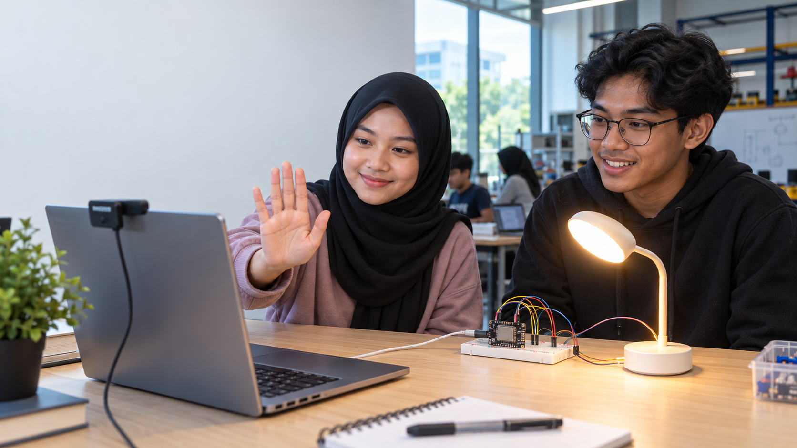
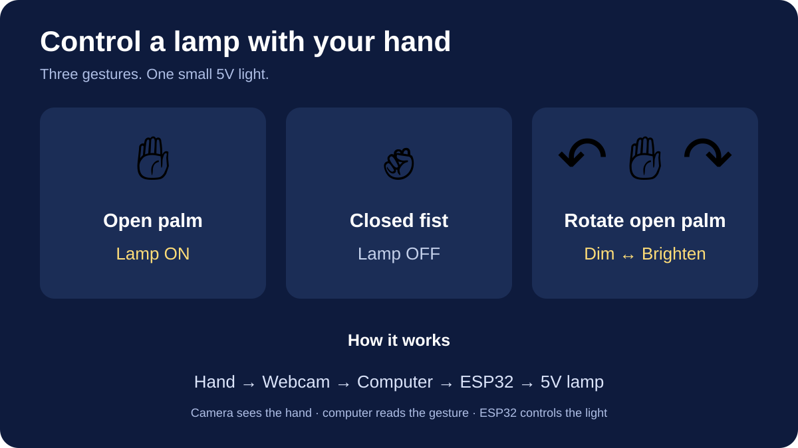
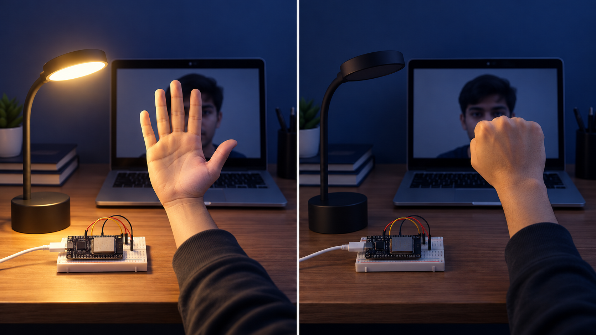
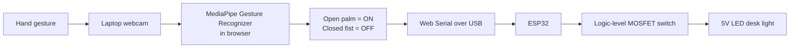

# Gesture-Controlled Desk Lamp
## GDGoC UM AI/ML × Robotics Engineering Club (REC) workshop proposal

**Decision requested:** Approve a joint beginner workshop built around a webcam-controlled, low-voltage LED desk light. Confirm the target date, participant capacity, kit budget, and which club will own procurement.

## Executive summary

Participants work in pairs to make a small light respond to hand gestures. A laptop webcam sees an open palm or closed fist. Google MediaPipe identifies the gesture in a browser page; the page sends an ON or OFF command over USB to an ESP32; the ESP32 switches a 5V LED light. Each pair leaves with a visible result and an understanding of the path from computer vision to physical output.

The core build needs no model training, cloud account, Wi-Fi setup, motors, or mains wiring. Rotating an open palm like a steering wheel to adjust brightness is an optional extension for pairs that finish early.

## Why this workshop

- **Clear collaboration:** GDGoC UM leads the vision and browser logic; REC leads the circuit, controller, and kit preparation.
- **Beginner friendly:** Two reliable gestures and a prepared starter project keep the first success within reach.
- **Memorable:** Everyone can raise a hand and illuminate their own light in a coordinated final demo.
- **Scalable:** One reusable kit per pair is enough; participants use their own laptops and webcams.

## Participant experience

1. Connect the ESP32 and the pre-checked 5V light circuit.
2. Open the starter page and grant camera and serial-port access.
3. Watch the page label **Open Palm** and **Closed Fist** as the hand changes.
4. Map open palm to ON and closed fist to OFF; verify the physical light responds.
5. If time permits, rotate an open palm left or right like a steering wheel to dim or brighten the light.

The page should require a gesture to be held briefly before sending a command, and only send a command when the intended state changes. This avoids flicker from momentary recognition errors.

## System flow

The webcam is the sensor. The ESP32 receives a simple command; it does not run the vision model. For optional dimming, the ESP32 varies the switch duty cycle using PWM. The LED's 5V supply and controller share a ground, but the LED current does **not** run through an ESP32 GPIO pin.

## Scope and learning outcomes

**Core outcome:** Each pair demonstrates open palm → light on and closed fist → light off.

**Optional extension:** Rotate an open palm in the plane facing the webcam, roughly 45° left to 45° right, to set brightness. The browser estimates the hand's angle from the index-finger and little-finger base landmarks, calibrates the participant's neutral position, and sends a clamped brightness value to the ESP32. The ESP32 uses PWM to dim the LED. Use a small dead zone and smoothing to prevent visible flicker; keep the last brightness if tracking is briefly lost. Twisting the palm until it faces away from the camera is less reliable and is outside this proposed gesture.

Participants learn what a pretrained gesture model returns, how a software event becomes a serial command, how a microcontroller controls an external load, and why simple filtering matters with live sensor input. No claim is made that participants train their own model.

## Recommended format

**Audience:** Beginners with basic laptop use; prior ML or electronics experience is not required.  
**Duration:** 2.5 hours.  
**Grouping:** Two participants per kit.  
**Planning example:** 40 participants = 20 kits, plus 2 spare kits. Adjust to actual registration.  
**Staffing:** One lead from each club, plus approximately one floating helper for every 8–10 pairs.

| Time | Activity | Lead |
|---|---|---|
| 0–15 min | Hook: live gesture-to-light demo, safety and learning goals | Both |
| 15–35 min | Explain webcam, MediaPipe, gesture labels, and commands | GDGoC UM |
| 35–60 min | Connect and test ESP32 and LED kit | REC |
| 60–105 min | Guided build: camera → gesture → USB command → light | Both |
| 105–125 min | Pair challenge: improve reliability; optional palm-rotation dimming | Both |
| 125–145 min | Room-wide demo, troubleshooting and showcase | Both |
| 145–150 min | Recap and feedback | Both |

## Hardware and software requirements

### Per pair

| Item | Quantity | Requirement / note |
|---|---:|---|
| ESP32 development board | 1 | Use one standard board model across all kits; confirm USB serial compatibility. |
| 5V LED light module or short LED strip with diffuser | 1 | Known voltage and current rating; accessible low-voltage leads. Makes a desk-light effect without modifying a sealed household lamp. |
| 3.3V-compatible logic-level MOSFET switching module | 1 | Rated above the LED's measured current; choose a module that works from ESP32 GPIO levels. |
| Breadboard | 1 | For the low-voltage control circuit. |
| Jumper wires | 5–8 | Prepare and label wires in each kit. |
| USB data cable for ESP32 | 1 | Match the chosen board connector; charge-only cables will fail. |
| Regulated 5V power supply for LED | 1 | Size to the chosen LED module; use a pre-made USB supply where practical. |
| Laptop with working webcam | 1 | Brought by pair or participants; Chrome desktop browser recommended for Web Serial. |

**Shared room items:** two spare kits for a 20-kit event, spare data cables, extension leads/power strips, projector and screen, stable lighting, and a facilitator's proven demo kit. Prepare a printed wiring card for the *specific* MOSFET module bought; module terminals differ.

**Software:** a prepared browser starter page using Google MediaPipe Gesture Recognizer, a downloadable gesture model, Web Serial, and pre-flashed ESP32 firmware. Run the page from `localhost` or HTTPS for camera and serial access. Preload assets or provide an offline copy if venue internet is uncertain. Chrome's desktop Web Serial support and the camera permission flow should be checked on the actual participant operating systems before the event.

## Preparation and responsibilities

| GDGoC UM AI/ML | REC | Joint |
|---|---|---|
| Prepare the browser demo and teaching material; set recognition threshold and brief hold time; test camera and Web Serial. | Choose and procure one kit design; verify LED current and MOSFET compatibility; flash identical firmware; check every circuit. | Pilot with 2–3 beginners, agree on participant count and budget, prepare troubleshooting cards, and rehearse the final demo. |

**Pre-event acceptance check:** A fresh laptop can open the starter page, grant permissions, connect the selected ESP32, and turn the light on and off repeatedly under normal room lighting. If this fails in the pilot, fix the kit or flow before ordering the full quantity.

## Safety and practical limits

- Use only an accessible **5V low-voltage** LED module in participant kits. Do not switch or expose household AC wiring during this workshop.
- Match the LED supply, module current rating, and wiring to the selected light. The ESP32 GPIO controls the MOSFET, not the lamp current.
- Disconnect power before rewiring; REC should inspect each kit before the session.
- Gestures can misread in poor lighting or with multiple hands in frame. Keep the core demo to one hand, two gestures, and a short hold time.
- Webcam access requires a participant permission click. The proposed design processes video locally in the browser; there is no need to record or upload it.

## Decisions and next steps

1. Agree on the capacity and whether kits are reusable club property or participant take-home items.
2. Have REC select and test one exact ESP32, MOSFET module, LED light, and power supply combination; obtain local quotations before setting the budget.
3. Run a small pilot with the starter page and two complete kits, then publish registration and final instructions.

## Technical references

- [Google AI Edge: Gesture Recognizer](https://ai.google.dev/edge/mediapipe/solutions/vision/gesture_recognizer) — pretrained gesture categories and hand landmarks.
- [Chrome Developers: Web Serial](https://developer.chrome.com/docs/capabilities/serial) — USB serial connection from a desktop browser.
- [Espressif: ESP32 LEDC/PWM](https://docs.espressif.com/projects/arduino-esp32/en/latest/api/ledc.html) — brightness control capability.
- [MDN: camera access](https://developer.mozilla.org/en-US/docs/Web/API/MediaDevices/getUserMedia) — permission and secure-context requirements.

*Concept illustrations are for presentation. Build from the tested wiring card and the selected parts, not from the images.*

