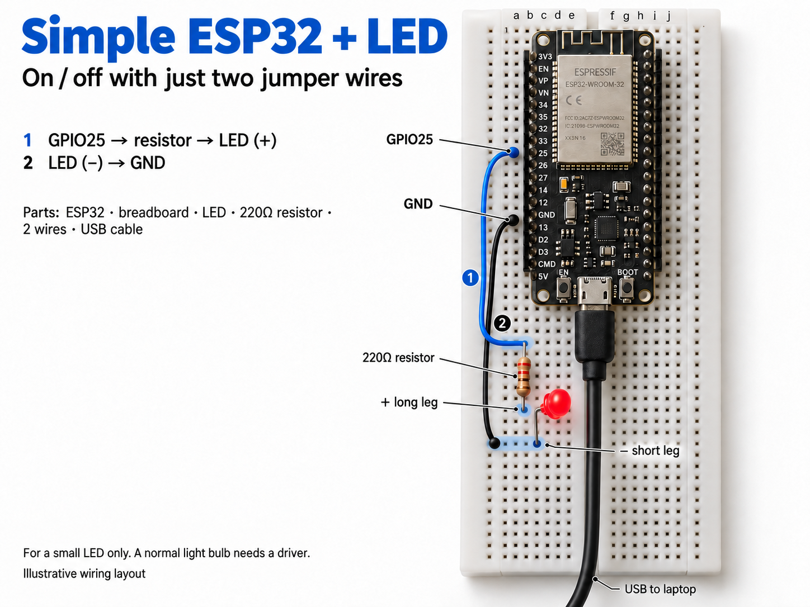

# Simple ESP32 + LED: on/off

This generated image illustrates the arrangement. Follow the electrical connections below when assembling it; the image is not a photograph of a tested circuit.

## Parts

One ESP32-DevKitC V4 with headers, one breadboard, one ordinary 5mm red LED, one 220Ω resistor, two jumper wires and one Micro-USB data cable.

## Exact connections

Unplug USB while wiring. Insert the ESP32 so its two header rows occupy opposite sides of the breadboard's centre gap, with at least the GPIO25/GND side accessible. Follow the board's printed pin labels rather than a pin position from a different ESP32 variant.

| Connection | How to place it |
|---|---|
| GPIO25 → resistor input | Blue jumper from a free hole sharing GPIO25's connected strip to a free lower strip A. One resistor end goes in a different hole of strip A. |
| Resistor output → LED positive | Other resistor end goes in strip B. LED long leg goes in another hole of that same strip B. |
| LED negative → GND | LED short leg goes in a different strip C. Black jumper connects another hole of strip C to a hole sharing the ESP32 GND pin's strip. |
| Laptop → ESP32 | Plug the USB data cable into the ESP32 after wiring. |

A, B and C must be three separate connected five-hole strips. On a standard breadboard, a–e of a numbered row are connected; f–j form a separate strip across the centre gap. Never insert both LED legs into one connected strip. The resistor and LED are in series, with no wire bypassing either component.

GPIO25 HIGH turns the LED on; LOW turns it off. USB powers the board. The webcam app still requires USB serial integration and ESP32 firmware to control this physical LED.

The absence of a MOSFET depends on the small LED's current requirement, not on whether brightness control is included. A regular bulb or higher-current LED module still requires a suitably rated driver and supply for on/off control.

References: [Espressif board pinout](https://docs.espressif.com/projects/esp-dev-kits/en/latest/esp32/esp32-devkitc/user_guide.html), [Adafruit LED wiring basics](https://learn.adafruit.com/adafruit-arduino-lesson-2-leds/breadboard-layout).

Image generated with the built-in imagegen tool. Prompt: realistic overhead ESP32 breadboard setup, two jumper wires, a 220Ω resistor and a small red LED, with labelled GPIO25/GND and LED polarity.
